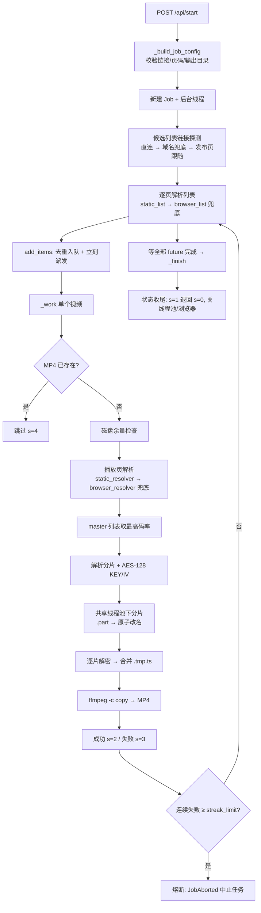

# 视频下载流水线

本地 / NAS / Docker 自托管的 HLS 视频下载工具，带一个零依赖的单页 Web 控制台。
核心能力：**列表页自动翻页 → 播放页自动找 m3u8 → AES-128 解密 → ffmpeg 合成 MP4**，
外加基于 VDF（video duplicate finder）的「画面内容查重」。

> 设计原则：不含任何站点专用逻辑。所有站点适配都靠**通用策略链（静态正则 → 加密
> blob 试解 → 无头浏览器兜底）**完成；**规则全部外置到 `app/rules/*.yaml`**，换站只改
> YAML 或新增一个解析器文件，不改核心代码；站点换域名只改界面上的链接。

---

## 1. 目录结构

| 路径 | 职责 |
| --- | --- |
| `main.py` | FastAPI 入口：路由、参数校验、lifespan（孤儿 chromium 清理、崩溃日志）、静态页 |
| `index.html` | 单页控制台（原生 JS，无构建步骤） |
| `app/core/models.py` | Pydantic 模型：`JobConfig` / `VideoItem` / `JobSnapshot` / `DedupConfig` 等 |
| `app/core/parsing.py` | 解析器接口（`ListParser` / `Resolver`）+ 运行期上下文 `ParserContext`；解析器在 `Job` 里显式实例化 |
| `app/core/rules.py` | **规则引擎 `RuleManager`**：加载并编译 `rules/*.yaml`，解析器/Job 唯一取数入口 |
| `app/core/exceptions.py` | `StopJob` / `JobAborted` 流水线专用异常 |
| `app/parsers/` | 解析器实现：`list/static` / `list/browser` / `play/static` / `play/browser` |
| `app/rules/` | **规则配置（单一来源）**：`title_rules.yaml` / `link_rules.yaml` / `pipeline_rules.yaml` |
| `app/services/job.py` | **任务编排 `Job`**：组合列表解析、单视频 worker、HLS、浏览器/域名探测 |
| `app/services/job_state.py` | **任务状态 `JobState`**：状态/进度/快照/视频队列/日志缓冲/熔断计数 |
| `app/services/list_runner.py` | **列表流水线 `ListRunner`**：候选域名 → 列表页并发解析 → 有序入队派发 |
| `app/services/video_worker.py` | **单视频 `VideoWorker`**：播放页解析、下载、重试、跳过、失败记录 |
| `app/services/hls.py` | **HLS 下载器 `HlsDownloader`**：密钥/IV、分片池、解密合并、ffmpeg |
| `app/services/browser.py` | **浏览器会话 `BrowserSession`**：Playwright 启动、上下文复用、页面借还 |
| `app/services/domain.py` | **域名探测 `DomainProbe`**：直连/30x/CNAME/发布页跳转、运行期重探 |
| `app/services/dedup_service.py` | VDF 查重与清理状态机 `DedupService` |
| `app/toolkit/` | 工具：`codec` / `files`（文件与异步日志）/ `http` / `m3u8` / `segments` / `title` / `url` / `dns` |
| `tests/` | 单测（纯函数 + Job 状态机）与端到端加密 HLS 实测 |
| `Dockerfile` / `docker-compose.yml` | 镜像：系统 ffmpeg、VDF CLI、预置 AI 组件、chromium |

运行期产物：

- 输出目录 `<outdir>/`（默认 `OUTDIR` 或仓库根 `downloads/`）
  - `NNN_标题.mp4` — 成品
  - `NNN_标题.tmp.ts` — 解密合并中的中间流；失败时保留为 `.ts` 便于手工转封装
  - `NNN_标题.tmp.ts.parts/` — 分片缓存（断点续传用，成功后删除）
  - `manifest_web.json` — 本次解析出的视频清单
  - `_web_log.txt` — 任务日志（追加写，超过 5MB 自动轮转为 `.1`）
  - `_failed_web.txt` — 失败清单（可被一键重试复用）
  - `_vdf_results.json` / `_vdf_db/` — 查重结果与 VDF 帧哈希库
- 日志目录 `<outdir>/_logs/`（可用 `YS_LOG_DIR` 改）
  - `_server_dbg.log` — 未捕获异常
  - `_faulthandler.log` — faulthandler 崩溃栈（不再写进源码目录 `app/`）

> 停止与重启：uvicorn 收到 SIGTERM 时会走 lifespan 收尾——置停止信号、杀 ffmpeg 子进程、
> 回收分片线程池与浏览器；启动时会清理上次残留的 chromium（只按本项目启动标记匹配，
> 不再全机扫描 `ms-playwright`，不会误杀其它项目的 Playwright）。

---

## 2. 端到端流程



列表解析与下载是**流水线并行**的：每解析出一页，就立刻把这一页的视频提交给线程池。

---

## 3. 任务状态

### 3.1 视频状态 `video.s`

| 值 | 含义 |
| --- | --- |
| 0 | 排队中 |
| 1 | 进行中 |
| 2 | 完成 |
| 3 | 失败 |
| 4 | 跳过（目标 MP4 已存在） |

### 3.2 视频步骤 `video.step`

`1` 播放页 → `2` 密钥 → `3` 分片（带 `sd/sn` 进度）→ `4` 合成 → 完成态直接显示全亮。

### 3.3 全局阶段 `stages`

| 阶段 | 关键字段 | 说明 |
| --- | --- | --- |
| `list` | `pages/pages_total/found` | 列表页解析进度 |
| `play` | `resolved/total` | 播放页解析成功数 |
| `key` | `got/method/iv` | 密钥获取数、加密方式、IV 前缀 |
| `seg` | `done/skip/current` | 已完成分片总数、跳过数、当前视频 |
| `dec` | `ok/fail` | 解密/合成成功、失败数 |
| `out` | `count/gb/recent` | 产出数量、总体积、最近 8 条 |

进度条两段拼成：列表阶段 `2%~10%`，下载阶段 `10%~98%`（按 `ok+fail+skip/total`）。

### 3.4 查重状态 `DedupService.st`

`available` / `stage`（`idle/scanning/done/error`）/ `percent` / `current` / `groups`
（按可释放空间降序）/ `last_apply` / `log`。扫描与清理**刻意拆成两步**。

---

## 4. 规则与解析器（换站不用改代码）

### 4.1 规则外置

所有正则、关键词、阈值都收在 `app/rules/*.yaml`，运行期由 `RuleManager` 一次性加载编译：

- `title_rules.yaml`：标题清洗的分离符 / 前后缀 / 站名词 / 集数 / 套话。
- `link_rules.yaml`：列表页链接的排除词 / 扩展名 / 广告特征 / 播放页提示 / id 特征 / 标题块 class。
- `pipeline_rules.yaml`：熔断阈值、分片并发、重探冷却、磁盘下限、不可重试关键词、
  发布页提示、跳转信号、m3u8 正则、加密 blob 形态、浏览器触发/标题候选选择器、
  发布页按钮文字、页面新域名识别正则。

### 4.2 解析器策略

列表页与播放页解析都是 `ListParser` / `Resolver` 的实现，在 `Job._ensure_parsers()`
里**显式实例化**四种内置解析器（静态/浏览器 × 列表/播放页），依次「静态优先、浏览器兜底」。

新站点适配：

1. 若只需调整链接/标题规则 → 改 `app/rules/*.yaml`；
2. 若站点的页面结构特殊 → 在 `app/parsers/` 下新增一个解析器文件，继承对应基类并实现
   `parse` / `resolve`（`uses_browser=True` 的可实现 `*_with_page`），
   然后在 `Job._ensure_parsers()` 里登记它。

### 4.3 标题提取（`app/toolkit/title.py`）

**文件名以列表页标题为准**；只有列表页没拿到标题时，才用播放页自动识别的标题兜底。

播放页标题按 **og/twitter:title → meta[name=title] → 内容型 class →
h1 → JSON-LD name → `<title>` 拆段** 收集候选，再用「站名、页面套话、纯数字」过滤。

### 4.4 下载与合成

- `resolve_playlist` 最多下钻 3 层 master 列表，取 BANDWIDTH 最高档。
- `key_schedule` 按分片解析 `#EXT-X-KEY`（属性顺序无关、支持引号内逗号），支持：
  - **密钥轮换**（多个不同 URI 的 KEY，逐片切换）；
  - **中途转明文**（`METHOD=NONE`）；
  - 没有显式 IV 时按 RFC 8216 用**媒体序列号**派生每片 IV（不再全用 0 IV）。
- 分片用固定数量的下载协程消费下标（任务级共享线程池，先写唯一临时文件再
  `os.replace` 原子改名），几千片也不会瞬间创建几千个 Task。
- 每片单独 AES-128-CBC 解密（各自 PKCS7），顺序写入 `.tmp.ts`。
- `ffmpeg -c copy -movflags +faststart` 转封装（30 分钟超时），失败保留 `.ts`。

### 4.5 容错、重试与域名变化

| 层级 | 次数 | 触发 | 行为 |
| --- | --- | --- | --- |
| 单请求 | 3（分片 4） | 网络/HTTP 异常 | 2/4/6s 退避 + 抖动，期间检查停止信号 |
| 单视频 | 3（域名重探成功 +1） | 可重试错误 | 重新解析播放页；连不上先域名重探 |
| 标题预解析 | 2 | 列表页没拿到标题 | 先解析播放页取标题再判断跳过 |
| 熔断 | - | 连续 5 个失败 | 中止任务（成功一次清零计数） |
| 一键重试 | 手动 | 任务已结束 | 复位 `s=3` 与 `s=0` 重新派发 |

- **不可重试**：`pipeline_rules.yaml` 里的 `non_retryable` 关键词（找不到 m3u8、404、磁盘满、
  ffmpeg 失败、不支持的加密方式等）直接判失败。
- **磁盘保护**：输出目录剩余 < 5GB 立即中止。
- **域名变化**：任务开始与运行中都会按「直连 → HTTP 30x 采用最终域名 → 沿 DoH CNAME 链换
  同站主机名 → 发布页/JS/meta 跳转用浏览器跟随」探测，切域名后 `base`/`Referer`/后续翻页自动生效。
- **发布页/弹窗换域名**：列表入口或播放页出现发布页时，会尝试点击
  `publish_click_texts`；同时监听当前页打开的新标签页/弹窗，从新页面 URL 或
  “最新地址/新域名: xxx”文字里识别 host，切换整个任务的 base，并把已入队的旧域名 URL
  重写到新域名后重试当前视频。
- **运行中域名失效**：分片连续失败（或本次下载有分片最终失败）时不等普通视频重试，
  立即强制重探一次域名；切换成功后 `domain.epoch` 递增，所有正在下载的视频会丢弃旧
  m3u8、重新解析播放页（`.parts` 缓存按指纹决定续传或清空）。
- **列表页并发**：按 `pipeline.list_concurrency`（默认 3）同时抓取/解析多页，但结果仍按页码
  顺序入队，视频编号与日志顺序不变；连续两页无新增时取消窗口内剩余请求提前收工。

---

## 5. HTTP 接口

| 方法 | 路径 | 说明 |
| --- | --- | --- |
| GET | `/` | 控制台页面（`Cache-Control: no-store`） |
| GET | `/api/job` | 任务状态快照；无任务返回 `{"empty": true}` |
| GET | `/api/events` | 任务状态 SSE（前端优先使用，断开自动退回轮询） |
| POST | `/api/start` | `{list_url,p1,p2,outdir,workers}` 启动任务 |
| POST | `/api/stop` | 请求停止当前任务 |
| POST | `/api/retry_failed` | 重试失败/未完成视频，返回 `count` |
| GET | `/api/dedup/status` | 查重进度、分组、可用性 |
| POST | `/api/dedup/start` | `{dir,percent}` 启动扫描 |
| POST | `/api/dedup/stop` | 停止扫描 |
| POST | `/api/dedup/apply` | `{strategy,mode}` 执行清理 |

> 接口没有鉴权且默认监听 `0.0.0.0`，只适合本机/内网使用。

---

## 6. 配置

界面设置存浏览器 `localStorage`（`ys_cfg`）。服务端只有环境变量：

| 变量 | 默认 | 说明 |
| --- | --- | --- |
| `OUTDIR` | 仓库根 `downloads/` | 默认输出目录（容器里 `/downloads`） |
| `YS_HOST` | `0.0.0.0` | 监听地址（`python main.py` / 直接读 AppConfig 时生效） |
| `YS_PORT` | `8765` | 监听端口 |
| `YS_LOG_DIR` | `<OUTDIR>/_logs` | 运行期日志目录（`_server_dbg.log` / `_faulthandler.log`） |
| `YS_TLS_VERIFY` | 开 | 默认校验证书；设为 `0/false/no/off` 时关闭（兼容自签/证书异常站点） |
| `VDF_BIN` | 自动找 PATH | 查重可执行文件路径 |
| `VDF_SAMPLES` | `24` | 每视频采样帧数（1~200） |
| `VDF_AI` | 开 | 设为 `0/false/no/off` 关闭 AI 匹配两阶段 |
| `VDF_PARTIAL_MIN_RATIO` | `0.05` | 片段/源片最小时长比 |

`AppConfig.host/port` 默认读取 `YS_HOST` / `YS_PORT`，未设置时为 `0.0.0.0:8765`。

---

## 7. 运行与部署

本地（需 Python ≥ 3.11 与 ffmpeg）：

```bash
uv sync --no-dev
uv run uvicorn main:app --host 0.0.0.0 --port 8765 --reload
# 或
python main.py
```

容器：

```bash
docker compose up -d --build
```

> Dockerfile 会从 `uv.lock` 读取 Playwright 版本再安装对应浏览器，升级 `playwright`
> 后重新 build 镜像即可，不需要同步修改 Dockerfile。

测试：

```bash
python -m unittest discover -s tests -v      # 或
python -m pytest -q                          # pytest 配置在 pyproject.toml
```

- `test_pure.py`：m3u8/密钥计划/URL/编解码纯函数单测（不依赖网络）。
- `test_job_logic.py`：分片解密合并（含轮换密钥、逐片 IV）、一键重试进度、列表页并发有序性、异步日志。
- `test_modules.py`：拆分后的 JobState / DomainProbe / VideoWorker / 列表 API 兜底、
  HLS 缓存指纹与 TS 校验、分片失败触发域名恢复、epoch 中断在跑下载、发布页新域名识别
  与 URL 重写、TLS 默认值边界测试。
- `test_domain_popup.py`：用假页面对象验证“播放页弹窗/新标签页提示新域名”的识别。
- `test_dedup.py`：VDF 结果解析、保留项标记、文件名匹配、扫描视频枚举。
- `test_hls_integration.py`：现场用 ffmpeg 生成 AES-128 加密 HLS，起本地 HTTP 服务走完整
  `_hls_to_mp4` 链路；缺 ffmpeg/依赖时自动跳过。
- `test_pipeline_integration.py`：本地列表页 + 播放页 + 加密 HLS，跑完整 `Job.run()`
  （列表解析 → worker → 下载解密 → ffmpeg → 产出 MP4）。

### 代码质量

`pyproject.toml` 里已经配好 `[tool.ruff]` / `[tool.pytest.ini_options]` / `[tool.mypy]`：

```bash
uvx ruff check .          # 当前零告警
uv run python -m pytest -q
```

---

## 8. 重构与优化要点

1. **规则单一来源**：散落在 `parser_*.py` / `job.py` / `utils.py` 里的正则、关键词、阈值全部
   收敛到 `app/rules/*.yaml`，由 `RuleManager` 统一编译；解析器不再硬编码规则。
2. **解析器显式组装**：`Job._ensure_parsers()` 直接实例化四种内置解析器，新站点在 `app/parsers/`
   新增解析器文件并在此登记即可。
3. **依赖倒置**：`main.py` 只依赖 `app.services` 与 `app.core`，不再 import 旧模块。
4. **完整流水线**：新 `Job` 补齐浏览器兜底、域名探测/重探、一键重试、熔断、磁盘检查、日志落盘。
5. **前端契约不变**：`JobSnapshot` 的字段与 `index.html` 约定完全对齐，控制台无需改动即可工作。
6. **旧代码清理**：删除 `app/job.py` / `parser_*.py` / `state.py` / `dns.py` / `dedup.py` /
   `utils.py` / `hls.py` / `config.py` 与 `main_legacy.py`。
7. **性能**：列表页并发抓取（有序入队）、加密 SPA API 捕获仅作兜底、浏览器上下文整任务复用、
   分片用固定协程池消费、静态列表解析放线程、日志落盘/打屏移到后台线程、VDF 进度行用文件名索引匹配。
8. **健壮性**：HLS 密钥轮换/逐片 IV、分片缓存指纹（密钥/播放列表变化自动失效）、
   解密后 TS 结构校验（密钥/IV 错误提前失败）、发布页/弹窗新域名识别与 URL 重写、
   分片失败立即强制重探域名并以 epoch 让所有在跑视频重新解析、
   一键重试进度按视频状态重算、同时跟踪所有 ffmpeg 子进程（停止时全部回收）、
   `/api/dedup/apply` 不再阻塞事件循环、修复 Windows 孤儿 chromium 清理脚本的 PowerShell 花括号错误。
9. **前端**：优先使用 SSE 推送任务状态（失败自动退回自适应轮询）、日志按 `log_seq` 增量追加
   （不再在 400 行后冻结）、日志 DOM 只保留最近 800 行、查重面板后台不轮询、补充可访问性、
   移动端与 reduced-motion 样式。
10. **职责拆分**：`job.py` 从 1042 行降到约 340 行，只保留任务编排；状态、列表流水线、
    单视频 worker、HLS、浏览器、域名各自独立成模块，`Job` 对外接口保持不变。

## 9. 已知限制

- **fMP4（`#EXT-X-MAP` / `.m4s`）不支持**：现在会直接报「fMP4(EXT-X-MAP) 播放列表暂不支持」，
  不会再把几百个分片下完才在 ffmpeg 阶段报合成失败。
- 分片按 TS 处理，`EXT-X-BYTERANGE` 不支持；SAMPLE-AES 不支持（会明确报错）。
- 任务状态只在内存里，进程重启后一键重试不可用（`_failed_web.txt` 仍在）。
- 查重依赖外部 `vdf` CLI；Windows 下需自行放置可执行文件。
- 大列表全部保留在内存中，前端最多渲染 300 行。
- 换域名弹窗识别依赖页面出现“新域名/最新地址/发布页”等提示，或弹窗带 `opener`
  可关联到当前页；完全无提示的广告式跳转、`noopener` 弹窗不一定能识别。
- 运行中强制重探仍只探测列表 URL / 候选域名；旧域名仍可访问、页面也没有任何换域名提示时，
  程序无法自动发现新站，需要把新域名填进候选链接或重新运行任务。
- `.tmp.ts.parts/` 分片缓存有密钥/播放列表指纹校验，但不会自动过期；长期运行后仍建议手工清理。